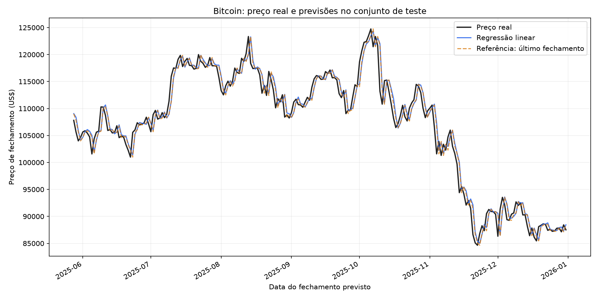
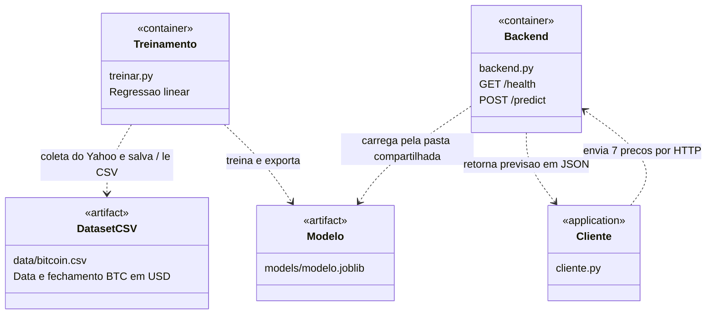
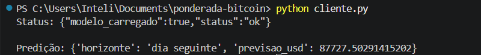
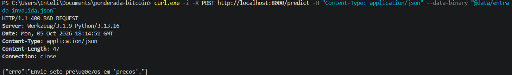

# Predição do Bitcoin com Docker

Atividade ponderada do Módulo 7 -- treinamento de um modelo e disponibilização de predições por um backend Python em Docker.

## Uso de IA

Usei ChatGPT como ajuda nas explicações e no desenvolvimento do código As decisões são discutidas comigo, e os resultados serão verificados durante a execução.
(não vou mentir que usei pra melhorar o markdown da documentação)

## Fonte dos dados

A fonte para os dados históricos é o Yahoo Finance, utilizando o Bitcoin em dólares (BTC-USD).

## Devlog

### 1. Definição da abordagem

Escolhi prever o preço de fechamento do Bitcoin em dólares para o dia seguinte usando os preços dos sete dias anteriores. Vou começar com regressão linear porque é simples e posso focar na integração entre treinamento, modelo salvo e backend em Docker. Os dados serão separados cronologicamente entre treino e teste, sem embaralhar.

### 2. Arquitetura e compartilhamento do modelo

Escolhi usar dois containers Docker, um para treinamento e outro para o backend Python, para separar a etapa que cria o modelo da etapa que oferece as predições. Isso para que o backend possa usar o modelo salvo sem precisar treinar a cada solicitação. O artefato será salvo em uma pasta compartilhada chamada models, porque isso permite que os dois containers acessem o mesmo arquivo sem precisar copiá-lo manualmente.

### 3. Aplicação cliente

Escolhi usar um script Python como aplicação cliente porque ele permite demonstrar a comunicação com o backend sem precisar fazer uma interface visual. O script enviará os sete preços de fechamento e exibirá a previsão retornada.

### 4. Período e armazenamento dos dados

Escolhi usar os preços diários de fechamento do Bitcoin de 2023 a 2025, que vou obter no Yahoo Finance, porque são três anos completos de histórico para treinar e testar o modelo. Os dados serão salvos em CSV para permitir repetir o treinamento sem precisar fazer uma nova coleta.

### 5. Bibliotecas utilizadas

Vou usar yfinance para coletar os dados do Yahoo Finance, scikit-learn para implementar a regressão linear e joblib para salvar o modelo. Essas bibliotecas permitem implementar a abordagem escolhida com pouco código.

### 6. Separação dos dados e avaliação

Vou separar os exemplos cronologicamente, usando 80% para treinamento e 20% para teste. Vou avaliar com MAE porque ele expressa o erro médio em dólares e facilita interpretar o resultado.

### 7. Resultado do treinamento

Executei o treinamento no Docker, usando 871 exemplos para treino e 218 para teste. O MAE foi de aproximadamente 1.518,22 dólares. O modelo foi exportado para ser carregado pelo backend.

### 8. Escolha do backend

Escolhi Flask para implementar o backend Python porque permite disponibilizar as operações de status e predição de forma simples. O modelo será carregado ao iniciar o serviço.

### 9. Teste da integração

iniciei o backend no Docker e executei o cliente Python. A operação de status confirmou que o modelo estava carregado, e a operação de predição retornou aproximadamente 87.727,50 dólares.

### 10. Comparação com uma referência

Vou comparar a regressão linear com uma referência simples que prevê o próximo fechamento como igual ao último preço conhecido. Usarei o mesmo conjunto de teste e o MAE para verificar se o modelo melhora a previsão em relação a essa regra.

### 11. Teste de entrada inválida

Testei a validação do backend enviando um JSON com apenas dois preços, mesmo que necessario seja sete. Enviei o conteúdo por arquivo para evitar problemas com as aspas no PowerShell. O backend retornou HTTP 400 e informou que deveriam ser enviados sete preços, confirmando a validação da quantidade de entradas.

### 12. Resultado da comparação

Comparei a regressão linear com uma referência que repete o último fechamento, usando os mesmos 218 exemplos de teste. A regressão apresentou MAE de 1.518,22 dólares, enquanto a referência apresentou 1.476,50 dólares. neste teste, a regressão não melhorou a previsão em relação à regra simples.

### 13. Tentativa de melhoria com Ridge

Vou tentar uma melhoria com Ridge, que penaliza coeficientes muito grandes e pode estabilizar a regressão quando as entradas são semelhantes. Vou separar uma parte final dos dados de treino para validação e comparar Ridge, regressão linear e a referência nessa parte. Só avançarei com Ridge se ele superar os dois na validação. Depois farei uma avaliação final.

### 14. Resultado da tentativa com Ridge

Testei Ridge com padronização das entradas. Na validação, o MAE foi de US$ 1.737,92, pior que a regressão linear, com US$ 1.709,47, e que a referência, com US$ 1.719,54. Por isso, o código manteve a regressão linear. No teste final, ela continuou pior que a referência.

### 15. Decisão de criar um gráfico

Vou criar um gráfico comparando os preços reais com as previsões da regressão linear e da referência no período de teste, para visualizar o desempenho e complementar a avaliação pelo MAE.

### 16. Nova tentativa de build

Repeti o build da imagem de treinamento sem alterar os arquivos. Na segunda tentativa, as dependências foram instaladas e a imagem bitcoin-treino foi criada com sucesso. Não confirmei a causa da primeira falha. Agora vou executar o script do gráfico usando o modelo já salvo, sem treinar novamente.

### 17. Execução do gráfico

Executei o script grafico.py dentro do container e ele gerou o arquivo evidencias/grafico-teste.png. O script carregou o modelo já salvo e comparou suas previsões com os preços reais e a referência nos 218 dias de teste, sem treinar novamente.

### 18. Análise do gráfico

No gráfico, observei que as previsões da regressão linear e da referência ficaram próximas dos preços reais, mas apresentaram atraso em algumas mudanças bruscas. A proximidade visual não significa que a regressão foi superior. no teste, a referência apresentou um MAE menor. O gráfico complementou a avaliação numérica e ajudou a visualizar essa limitação.



## Esboço UML — componentes e comunicação

O diagrama utiliza estereótipos para identificar containers, artefatos e aplicação cliente. As setas indicam as dependências e a troca de dados.



O treinamento salva o modelo na pasta `models` do computador, montada no container em `/app/models`. O backend monta a mesma pasta em modo somente leitura e carrega o arquivo ao iniciar. O cliente roda no computador e acessa o backend pela porta 8000.

## Como executar

Pré-requisitos: Docker Desktop iniciado e Python instalado para executar o cliente. Os comandos abaixo são para PowerShell, na pasta do projeto.

### 1. Treinar o modelo

```powershell
New-Item -ItemType Directory -Force data, models
docker build -f Dockerfile.treino -t bitcoin-treino .
docker run --rm --mount "type=bind,source=$($PWD.Path)\data,target=/app/data" --mount "type=bind,source=$($PWD.Path)\models,target=/app/models" bitcoin-treino
```

Se `data/bitcoin.csv` existir, o treinamento reutiliza esse arquivo. Caso contrário, coleta os dados do Yahoo Finance, precisando de internet. O build das imagens também precisa de internet para baixar as dependências.

### 2. Iniciar o backend

```powershell
docker build -f Dockerfile.backend -t bitcoin-backend .
docker run --rm -p 8000:8000 --mount "type=bind,source=$($PWD.Path)\models,target=/app/models,readonly" bitcoin-backend
```

Mantenha esse terminal aberto. Para encerrar o backend, pressione Ctrl+C.

### 3. Executar o cliente em outro terminal

```powershell
python cliente.py
```

O cliente consulta `GET /health` e envia os sete preços de `data/exemplo.json` para `POST /predict`, em ordem do mais antigo ao mais recente.

### 4. Gerar o gráfico do conjunto de teste

```powershell
docker run --rm --mount "type=bind,source=$($PWD.Path),target=/app" bitcoin-treino python grafico.py
```

O gráfico será salvo em `evidencias/grafico-teste.png`. O script utiliza o CSV e o modelo já salvo, sem executar um novo treinamento.

## Resultados observados

- Exemplos de treinamento: 871.
- Exemplos de teste: 218.
- MAE no teste: US$ 1.518,22.
- Status retornado: `{"modelo_carregado":true,"status":"ok"}`.
- Predição retornada: US$ 87.727,50.

A predição usa os últimos sete fechamentos do CSV. O horizonte é o dia seguinte ao último registro, e não necessariamente o dia seguinte à execução do cliente.

## Evidência da execução

O cliente consultou o status do backend e recebeu uma predição.



### Teste de entrada inválida

```powershell
curl.exe -i -X POST http://localhost:8000/predict -H "Content-Type: application/json" --data-binary "@data/entrada-invalida.json"
```



## Limitações

- A regressão linear utiliza apenas sete preços anteriores, sem notícias, volume ou outros fatores.
- O MAE representa o erro médio observado no teste e não garante o desempenho futuro.
- O backend usa o servidor de desenvolvimento do Flask para demonstração local.
- As predições são experimentais e não representam recomendações de investimento.